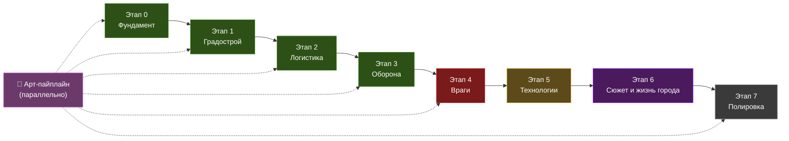

# Project: Aegis-Hive — Дорожная карта разработки v2

> **Жанр:** Изометрический градостроительный симулятор / стратегия / sci-fi  
> **Движок:** Godot 4.7.2 (GDScript)  
> **Перспектива:** Изометрия (2.5D), послойная визуализация динамических уровней  
> **Рабочая директория:** `c:\dev\MegaProject`

---

## Общая философия разработки

- **Итеративность:** Каждый этап заканчивается играбельным билдом.
- **Готовые решения:** Максимально используем проверенные аддоны, open-source ассеты и плагины Godot из Asset Library и GitHub. Своё пишем только когда нет подходящего решения.
- **Арт-пайплайн параллелен коду:** Графика разрабатывается не «когда-нибудь потом», а идёт рука об руку с каждым этапом — сначала плейсхолдеры, затем постепенная замена на финальные ассеты.

---

## Структура этапов

---

## 🎨 Арт-пайплайн (параллельный трек)

Графика и визуал развиваются параллельно коду. На каждом этапе — свой набор арт-задач.

| Фаза | Привязка к этапу | Задачи |
|---|---|---|
| **Плейсхолдеры** | Этапы 0–1 | Цветные прямоугольники и простые формы для всех зданий и тайлов. Достаточно для тестирования механик. Используем бесплатные изометрические пак-ассеты как основу |
| **Тайлсет ландшафта** | Этап 0–1 | Изометрические тайлы поверхности планеты: скалы, грунт, руда, разломы. Поиск готовых sci-fi tileset'ов (Kenney.nl, itch.io, OpenGameArt) |
| **Спрайты зданий v1** | Этап 1–2 | Изометрические спрайты каждого типа здания (64×64 или 128×128 base). Стилистика: тяжёлый индустриальный sci-fi, бетон + металл + неоновые индикаторы (Завершено для всех 11 типов зданий) |
| **Спрайты зданий v2 (состояния)** | Этап 3 | Варианты спрайтов: целое → повреждённое → разрушенное. Анимации строительства |
| **Враги и существа** | Этап 4 | Спрайты местной фауны (рои, хищники). Спрайты/анимации Сущностей — крупные, детализированные, с VFX-слоями |
| **VFX и шейдеры** | Этап 3–4 | Частицы: выстрелы турелей, щиты (шейдер полупрозрачного купола), взрывы, дым. Шейдер прозрачности неактивных ярусов |
| **UI-кит** | Этап 6–7 | Финальный дизайн интерфейса: панели, кнопки, иконки зданий, портреты персонажей для диалогов |
| **Полировка** | Этап 7 | Атмосферные эффекты: туман, пыль, всполохи на горизонте. Анимации idle для зданий (дымящие трубы, мигающие огни) |

> [!TIP]
> **Стратегия ускорения:** Начинаем с бесплатных/купленных ассет-паков, модифицируем под стилистику игры. Рисуем с нуля только уникальные элементы (Сущности, мегапроекты).

---

## Этап 0: Фундамент проекта

**Цель:** Настроенный проект Godot, базовая архитектура кода, пустая изометрическая сцена с динамической системой ярусов.

| Задача | Описание |
|---|---|
| Структура проекта | Создание директорий: `scenes/`, `scripts/`, `assets/`, `ui/`, `data/`, `autoload/`, `addons/` |
| Главная сцена | Изометрическая сцена с `Camera2D`, обработка ввода (WASD — панорамирование, колёсико — зум, Q/E — переключение ярусов) |
| Изометрическая сетка | `TileMapLayer` с изометрической проекцией (tile size 128×64), плейсхолдерные тайлы |
| **Динамическая система ярусов** | Город начинается на поверхности (z=0). Игрок может **строить вверх** (возведение новых платформ, z+1, z+2...) и **копать вниз** (бурение/раскопка, z-1, z-2...). Каждый новый ярус — динамически создаваемый `TileMapLayer`. Ярусы не имеют предопределённого назначения — игрок сам решает, что строить на каждом уровне |
| Визуализация ярусов | Активный ярус — полная непрозрачность. Ярусы выше/ниже — `modulate.a` от 0.15 до 0.3, с затуханием по удалённости. Ярусы далее ±2 от текущего — скрыты |
| Миникарта | `SubViewport` + `TextureRect` в углу: вертикальная схема-столбец ярусов, клик для переключения. Показывает какие ярусы существуют, какой активен |
| Game Bus (Autoload) | Глобальные синглтоны: `GameState`, `EventBus` (сигналы), `ResourceManager` |

> [!IMPORTANT]
> **Ключевое изменение:** Ярусы не фиксированы. Игрок сам определяет вертикальный рост города. Строительство нового яруса вверх требует возведения опорных конструкций. Раскопка яруса вниз требует буровых установок и времени. Это создаёт стратегический выбор: расширяться горизонтально (дешевле, уязвимее) или вертикально (дороже, компактнее, защищённее).

**Результат:** Можно запустить игру, двигать камеру, создавать новые ярусы, переключаться между ними.

---

## Этап 1: Ядро градостроительства

**Цель:** Можно ставить здания, они занимают тайлы, потребляют/производят ресурсы.

| Задача | Описание |
|---|---|
| Система зданий | Базовый класс `Building` (GDScript): размер, ярус, стоимость, HP, статус. Данные зданий в `.tres` (Godot Resource) |
| Размещение зданий | Режим строительства: выбор здания → полупрозрачный призрак на курсоре → клик → проверка коллизий и ограничений яруса |
| Создание нового яруса | «Построить платформу вверх» (требует опорные колонны + стройматериалы). «Пробурить вниз» (буровая установка + время + энергия). Каждый новый ярус начинается пустым |
| Базовые ресурсы | Энергия, Руда, Стройматериалы, Население. HUD-панель ресурсов сверху экрана |
| Первые здания | Командный центр (стартовое), Термоядерный реактор (энергия), Карьер (руда), Завод (стройматериалы), Жилой блок (население), Опорная колонна (несущая конструкция для верхних ярусов), Буровая установка (раскопка нижних ярусов) |
| Тиковая система | Игровой цикл: каждый тик (×1/×2/×3/пауза) здания производят/потребляют ресурсы |
| Снос | Удаление зданий с возвратом части ресурсов. Предупреждение при сносе опорных колонн! |

**Результат:** Градострой-песочница — ставим здания, растём вверх и вниз, следим за ресурсами.

---

## Этап 2: Логистика и связи (Завершён ✅)

**Цель:** Здания не работают в вакууме — им нужны энергосети, транспорт и снабжение.

| Задача | Описание |
|---|---|
| Энергосеть | Кабели между зданиями. Граф связности `PowerGrid`: реактор отключен → вся ветка обесточена |
| Транспортные маршруты | Конвейерные линии `SupplyChain`. Руда из карьера → завод → склад |
| Вертикальные шахты-лифты | Связь между ярусами через `ShaftElevator` 2×2. Без лифта ярус изолирован от энергии и снабжения |
| Оверлей сетей | Визуализация `NetworkOverlay` (F1 — энергия, F2 — транспорт), кнопки в HUD `OverlayToggle` |

**Результат:** Логистическая система полностью реализована: `PowerGrid`, `SupplyChain`, `ShaftElevator`, `NetworkManager`, оверлеи (F1/F2), серийная прокладка (`Mode.CABLING`) и интеграция в `TickManager`. Все тесты T2.1–T2.10 успешно пройдены (Exit code 0).

---

## Этап 3: Оборонительные системы (Завершён ✅)

**Цель:** Город способен защищаться — турели, щиты, бронепалубы, структурная целостность, директивы и исследования.

| Задача | Описание |
|---|---|
| [x] Оборонительные здания | Автотурель, Тяжёлый рейлган, Генератор щита (2:1 купол, ест энергию), Вышка датчиков (+20% дальности), Патронный завод, Ремонтное депо |
| [x] Стены и бронепалубы | Бронестена (`WallNode`, динамический блок пути A*/BFS) и Бронепалуба (`ArmorDeck`, `z >= +1`, защита нижележащих ярусов от орбитальных/воздушных атак + проекция `[F4]`) |
| [x] Система урона и HP | Повреждение → снижение КПД (`get_efficiency()`) → оверлей трещин `<50% HP` → руины (`0 HP`) → расчистка с возвратом `25%` |
| [x] Протокол «Эгида» и Директивы | Единая панель `CommandPanel`: немедленный боевой энергопереброс (отключает добычу/жилые блоки), динамические приоритеты `#1..#4`, исследуемый во вкладке «Исследования» протокол «Эгида» (укрытие населения + принудительная готовность щитов) |
| [x] Структурная целостность | Разрушение опорных колонн → индуктивная проверка всех ярусов выше, каскадный урон (`-35%`) и тиковый износ конструкций (`0.10 HP/тик`) до восстановления опоры |

**Результат:** Оборона и командная логика колонии полностью реализованы и интегрированы в бруталистский адаптивный HUD (`1920×1080` и `1280×800`). Автотесты `T3.1–T3.13`, `GUI.T1–GUI.T13`, `L.T1–L.T4` пройдены с Exit code 0.

---

## Этап 4: Враги и боевая система

**Цель:** На город нападают — фауна, катаклизмы, Сущности.

| Задача | Описание |
|---|---|
| Система событий | `ThreatManager`: генерация по таймеру, прогрессу и рандому |
| Местная фауна | Враги с pathfinding (A*): рои (много слабых), хищники (мало сильных). Лезут в вентиляцию, грызут кабели |
| Катаклизмы | Сейсмический толчок (урон нижним ярусам, трещины в опорах), Ионная буря (блэкаут открытых сетей), Кислотный дождь (урон верхним ярусам) |
| Сущности (боссы) | Уникальные скриптованные враги. Колоссальный масштаб, неуязвимость к обычному урону, требуют концентрации энергии всего города |
| Система боеприпасов | Турели стреляют снарядами, которые производятся на заводах и доставляются логистикой. Нет снарядов → молчание пушек |
| Ремонт | Ремонтные дроны/бригады: автоматическое восстановление после боя |

**Результат:** Полный цикл: строй → развивай → обороняй → восстанавливай → строй лучше.

---

## Этап 5: Дерево технологий и прогрессия

**Цель:** Развитие от базовых технологий к мегапроектам.

| Задача | Описание |
|---|---|
| Исследовательский центр | Здание, генерирующее «очки исследований» |
| Дерево технологий | Ветки: Энергетика, Оборона, Инфраструктура, Ксенонаука. Разблокировка новых зданий |
| Ксенотехнологии | Ядра побеждённых Сущностей → уникальные технологии (резонансные щиты, гравитационные ловушки) |
| Мегапроекты | Эндгейм: Планетарный щит, Буровая «Сердце», Позитронный ускоритель |

---

## Этап 6: Сюжет, диалоги и жизнь города

**Цель:** Город живёт, люди говорят, новости бегут, сюжет разворачивается.

### 6.1 Сюжетная кампания (3 Акта)

| Задача | Описание |
|---|---|
| Сюжетные брифинги | Полноэкранные диалоги с портретами: директор проекта, главный учёный, офицер связи с Землёй |
| Сюжетные триггеры | Прогрессия: первая Сущность → приказ бурить → обнаружение аномалии → Белое Сердце |
| Директивы Земли | Выборы с последствиями: выполнить жёсткий приказ или саботировать |
| Финал | Открытие каверны, финальная дилемма, множественные концовки |

### 6.2 Живой город — система постоянных диалогов

| Задача | Описание |
|---|---|
| Советники / Министры | Персонажи при дворе: Министр энергетики, Начальник обороны, Главный инженер, Учёный-ксенолог. Периодически обращаются с просьбами, предупреждениями, советами. Их реплики зависят от состояния города |
| Голос народа | Периодические петиции/жалобы от населения: «Жилой сектор D-7 обесточен третьи сутки!», «Хищники замечены у вентиляционной шахты 12» |
| Новостная бегущая строка | **В стиле Cities: Skylines** — полоса внизу экрана с новостями города: «⚡ Реактор-3 вышел на полную мощность», «🔴 Конвой с рудой атакован фауной на секторе G», «🏗️ Ярус -2 полностью застроен», «📡 Получена директива с Земли», «👥 Население достигло 10 000» |
| Контекстные реплики | Советники реагируют на действия игрока: при постройке оружия — Начальник обороны доволен, Учёный просит ресурсы на лабораторию |

> [!NOTE]
> Новостная строка — не просто флейвор. Она сообщает о важных событиях, которые игрок мог пропустить: обрыв энергосети, гибель конвоя, приближение бури. Это вторая система оповещения помимо алертов.

---

## Этап 7: UI, полировка, звук

| Задача | Описание |
|---|---|
| Финальный UI/HUD | Панели ресурсов, панель зданий, миникарта ярусов, оповещения, меню паузы, новостная строка |
| Звуковой дизайн | Индустриальный эмбиент, сирены тревоги, грохот турелей, гул реакторов |
| Музыка | Меланхоличный sci-fi (эмбиент в мирное время → напряжённый при атаке) |
| VFX | Частицы, шейдеры щитов, прозрачность ярусов |
| Туториал | Первые 15 минут: строительство, логистика, первая оборона |
| Баланс | Кривая сложности, расход ресурсов, темп атак |

---

## Готовые решения и аддоны (Accelerators)

> [!TIP]
> Стратегия: **не изобретать велосипед**. Для каждой крупной системы сначала ищем готовое решение, адаптируем, и только если не подходит — пишем своё.

| Область | Готовое решение | Источник |
|---|---|---|
| Изометрия и тайлмапы | Встроенный `TileMapLayer` Godot 4 | Движок |
| Диалоги и сюжет | **Dialogic 2** — полнофункциональный аддон для диалогов с портретами, ветвлением, переменными | [GitHub](https://github.com/dialogic-godot/dialogic) |
| Конечные автоматы (FSM) | **LimboAI** — Behavior Trees + HSM для AI врагов и состояний зданий | [GitHub](https://github.com/limbonaut/limboai) |
| Pathfinding | `AStarGrid2D` (встроенный) или `NavigationServer2D` | Движок |
| Сохранения | **SaveMadeEasy** или ручная сериализация через `ResourceSaver` | Asset Library |
| UI-фреймворк | Встроенные `Control`-ноды Godot + готовые sci-fi UI-темы | Asset Library / itch.io |
| Изометрические ассеты | **Kenney.nl** (бесплатные паки), **itch.io** sci-fi tileset'ы | kenney.nl, itch.io |
| Звуки | **freesound.org**, **Kenney.nl** sound packs | Открытые библиотеки |
| Шейдеры | **Godot Shaders** — репозиторий готовых шейдеров (прозрачность, щиты, свечение) | [GitHub](https://github.com/GDQuest/godot-shaders) |
| Локализация | Встроенная система `TranslationServer` + CSV/PO-файлы | Движок |

---

## Технические решения (обновлено)

| Аспект | Решение |
|---|---|
| Движок | Godot 4.7.2 |
| Язык | GDScript (прототип), миграция горячих путей на C# / GDExtension при необходимости |
| Рендер | 2D изометрия, `TileMapLayer` для сетки, `Sprite2D` / `AnimatedSprite2D` для зданий |
| **Ярусы** | **Динамические.** Массив `TileMapLayer`, создаваемых по требованию игрока. z=0 — поверхность, z>0 — вверх, z<0 — вниз. Активный ярус — полная видимость, соседние — полупрозрачны, остальные — скрыты |
| Данные зданий | `.tres` (Godot Resources), экспортируемые в редакторе |
| Pathfinding | `AStarGrid2D` |
| Диалоги | Dialogic 2 |
| AI врагов | LimboAI (Behavior Trees) |
| Состояние игры | Autoload-синглтоны: `GameState`, `EventBus`, `ResourceManager`, `ThreatManager`, `LayerManager` |
