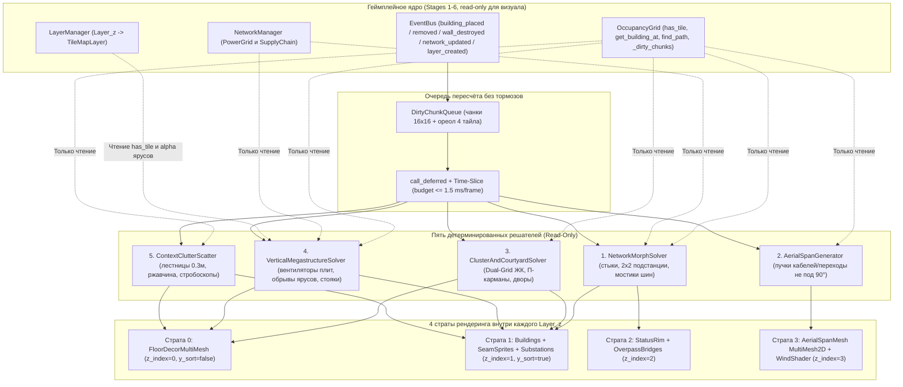

# PROCEDURAL MEGACITY PLAN — Процедурный мегагород, магистрали и техно-хаос «Aegis-Hive»

> **Статус документа:** Канонический архитектурный план процедурной генерации внутри репозитория (синхронизирован с артефактом [`procedural-megacity-plan.md`](file:///C:/Users/Amirrima37/.gemini/antigravity/brain/6cacdf2e-007e-45d7-84c5-378fba80c9fc/procedural-megacity-plan.md)).  
> **Порядок внедрения:** Лёгкие пре-хуки нулевого риска закладываются точечно на **Этапах 4–6**, полное развёртывание 5 процедурных подсистем, атласов и GPU-шейдеров — на **Этапе 7** (Фазы A–D).  
> **Движок и канон:** Godot `4.7.2 stable` (`GDScript`, изометрия `128×64` / `2:1 DIAMOND_DOWN`), Blender `5.2` (`BLENDER_EEVEE`, `ORTHO`, `(60.0°, 0.0°, 45.0°)`).  
> **Стилистический фундамент:** [STYLE_GUIDE.md](STYLE_GUIDE.md) и [STYLE_DEEP_RESEARCH.md](STYLE_DEEP_RESEARCH.md) — циклопический брутализм *Girls' Last Tour*, милитаризм Геофронта *Neon Genesis Evangelion*, бетонно-кабельные лабиринты *BLAME!* без неонового гламура и «игрушечной блочности».

> [!IMPORTANT]
> **Ключевой принцип безопасности (Read-Only Presentation Layer):** ни одна процедурная визуальная подсистема **никогда** не мутирует [`OccupancyGrid`](../scripts/buildings/occupancy_grid.gd#L1-L195), [`PowerGrid`](../scripts/networks/power_grid.gd#L1-L128), [`SupplyChain`](../scripts/networks/supply_chain.gd#L1-L126), баланс ресурсов, коллизии турелей или путь `find_path()`. На Этапах 4–6 вносятся только минимальные структурные заделы, а весь тяжёлый визуальный стек включается на Этапе 7.

---

## Содержание
1. [Синтез индустриальных референсов под канон Aegis-Hive](#1-синтез-индустриальных-референсов-под-канон-aegis-hive)
2. [Архитектура презентационного слоя: `ProceduralVisualDirector`](#2-архитектура-презентационного-слоя-proceduralvisualdirector)
3. [Пять процедурных подсистем мегаструктуры](#3-пять-процедурных-подсистем-мегаструктуры)
4. [Оптимизация под Godot 4.7.2 для 1000+ зданий](#4-оптимизация-под-godot-472-для-1000-зданий)
5. [Оффлайн-пайплайн Blender 5.2 Geometry Nodes и система сокетов](#5-оффлайн-пайплайн-blender-52-geometry-nodes-и-система-сокетов)
6. [Распределение задач по Этапам 4–7 (Что закладывать на каждом этапе)](#6-распределение-задач-по-этапам-47-что-закладывать-на-каждом-этапе)
7. [Внутренняя детализация Фаз A–D на Этапе 7 и план верификации](#7-внутренняя-детализация-фаз-ad-на-этапе-7-и-план-верификации)

---

## 1. Синтез индустриальных референсов под канон Aegis-Hive

Чтобы избежать «процедурного шума» (мелкой хаотичной паутины и пластиковых домиков), мы берём конкретные математические решения из проверенных индустриальных проектов и адаптируем их под **2:1 диметрическую изометрию** и манифест [STYLE_DEEP_RESEARCH.md](STYLE_DEEP_RESEARCH.md#L6-L77).

| Источник / Проект | Механика и алгоритм | Как переносим в *Aegis-Hive* | Защита от нарушения стиля |
|---|---|---|---|
| **Townscaper** (Oskar Stålberg) | Двойная сетка (**Dual-Grid**), смещение морфинга на узлы между тайлами, **marching-cubes / `15→6` симметрий**, детекция замкнутых контуров (дворов) через Flood-Fill + локальный WFC радиусом 2. | Вместо нарезания `47` вариантов жилых блоков используем **узлы-стыки `(x+0.5, y+0.5)`** (`16` битовых масок) для срастания `habitation_block` в цельный «ЖК» + ограниченный BFS для «П»-карманов и закрытых дворов. | Никакой «пасторальной плитки» или милых газонов: во дворах растут вентшахты-турбины, цистерны хладагента, решётчатые настилы и янтарные прожекторы ([STYLE_DEEP_RESEARCH.md](STYLE_DEEP_RESEARCH.md#L46)). |
| **Tiny Glade** (Anastasia Opara / Tomos) | Двухпроходная генерация (**Pass 1**: детекция пересечений сегментов, **Pass 2**: спавн геометрии за 1–2 мс); «химия элементов»; ленивые запросы координат; промоушен элементов при росте локального веса. | **Локальная реактивность за 1–2 мс** через пересчёт только грязных `16×16` чанков (`DirtyChunkQueue`). Пересечение *энергокабель × конвейер* или `2×2` скопление кабелей превращается в **подстанцию/котельную**, а две параллельные нитки конвейера спавнят **верхний мостик персонала**. | Строго соблюдаем *Human-to-Titan Scale* ([STYLE_DEEP_RESEARCH.md](STYLE_DEEP_RESEARCH.md#L72)): мостики с поручнем `1.0м`, инспекционные лестницы `0.3м`, глухие стены и грубый вибробетон. |
| **Factorio** (FFF-269, FFF-416) | Разделение логического графа и визуальных «заплаток»; метод **`front_patch` / `back_patch`** на стыках; отказ от зеркального `flip_h` у изометрии со светом слева-сверху (отдельные ориентированные рендеры). | Логика в [`PowerGrid`](../scripts/networks/power_grid.gd#L23-L128) и [`SupplyChain`](../scripts/networks/supply_chain.gd#L18-L126) остаётся нетронутой. Для узлов пересечений рендерим раздельные переднюю и заднюю части или многотайловый оверпас. Отдельные Blender-рендеры (`_rot.png`, `_corner.png`) без `flip_h`. | Используем уже сгенерированные, но пока неподключённые `39` спрайтов из [`normalize_building_sprites.py`](../scripts/tools/normalize_building_sprites.py#L23-L70) (`_rot.png`, `_corner.png`). |
| **TileMapDual** (Godot, `pablogila/TileMapDual`) | Жёсткое разделение `world tiles` (логическая сетка) и смещённой на полтайла `display tiles` сетки с изометрическим режимом (`15` полных / `6` уникальных Dual-тайлов). | Идеально для обрывов несущих плит ярусов (`!has_tile`), сшивных секций стен и швов «срастающихся ЖК» под единственным `y_sort_enabled = true`. | Индикаторная рамка **Diegetic Status Rim** остаётся на `Z = 0` у логических границ зданий ([STYLE_GUIDE.md](STYLE_GUIDE.md#L30-L35)), чтобы визуальное слияние не ломало читаемость клика и статуса. |
| **Satisfactory / Cloud Gardens / Godot-Catenary** | Провисание цепных линий по точной кривой **catenary** ([Alan Zucconi](https://www.alanzucconi.com/2020/12/13/catenary-2/), [`Donitzo/godot-catenary`](https://github.com/Donitzo/godot-catenary)); жёсткие трассы с зажимными муфтами от крыши к крыше без «паутинного шума». | Строим воздушные **магистральные пучки** между `RoofSocket`-точками зданий *не под 90°* с фильтрацией по графу Габриэля и угловому порогу `Δθ ≥ 32°`, `deg ≤ 3`. Плюс GPU-шейдер легкого раскачивания от ветра. | «Функциональная честность» ([STYLE_DEEP_RESEARCH.md](STYLE_DEEP_RESEARCH.md#L11)): пучок имеет толстый профиль (`6–12` пикс.), латунные гермовводы в крышу, бирки хомутов и реальный провес по физике. |
| **Dystopika** | Контекстный raycast по соседним плоскостям фасадов для авторазмещения вывесок, вентиляторов, ферм и прожекторов без вмешательства игрока. | После пересчёта чанка проверяем *видимые* юго-западную и юго-восточную кромки (не перекрытые высоким зданием спереди) и наносим проёмы турбин, потеки ржавчины и трафаретные маркеры секторов. | Исключаем киберпанковые голограммы/неон — только янтарные прожекторы, свинцовый сурик и ржавчина *Empty Signifier*. |

---

## 2. Архитектура презентационного слоя: `ProceduralVisualDirector`

Главный архитектурный императив: **единая точка входа через `EventBus`, полное отсутствие обратных зависимостей в геймплей и абсолютный детерминизм по координатам**.

### 2.1. Диаграмма потока данных и изоляции геймплея



### 2.2. Инвариант детерминизма (Устойчивость к порядку стройки и загрузки)

> [!CAUTION]
> **Частая ошибка процедурных систем:** использование глобального `randi()` или перебор `BuildingManager.get_all_buildings()` в порядке создания нод. В этом случае загрузка сохранения или снос одного здания заставляет «мигать» соседние декорации по всей карте.

Все 5 решателей обязаны вычислять случайные числа строго из **пространственного хеша координаты** и постоянного `world_seed` из `GameState`:

```gdscript
# Чистая детерминированная функция хеширования (без глобального состояния RNG)
static func hash_cell(z: int, x: int, y: int, salt: int, world_seed: int) -> int:
	var h: int = world_seed ^ (salt * 0x9E3779B9)
	h = ((h ^ (z * 0x85EBCA6B)) * 0xC2B2AE35) & 0xFFFFFFFF
	h = ((h ^ (x * 0x27D4EB2F)) * 0x165667B1) & 0xFFFFFFFF
	h = ((h ^ (y * 0x9E3779B1)) * 0x85EBCA6B) & 0xFFFFFFFF
	h ^= h >> 16
	return h

static func hash_edge(z: int, p1: Vector2i, p2: Vector2i, world_seed: int) -> int:
	# Симметричный порядок вершин: ребро (A->B) всегда равно (B->A)
	var a := p1 if (p1.x < p2.x or (p1.x == p2.x and p1.y <= p2.y)) else p2
	var b := p2 if a == p1 else p1
	return hash_cell(z, a.x * 73856093 ^ b.x, a.y * 19349663 ^ b.y, 0x517CC1B7, world_seed)
```

### 2.3. Правило неразрушения тактического чтения (Diegetic Safety)

1. При любом визуальном «срастании» жилых блоков, обвесе трубами и кабелями, **окантовка `StatusRim`** ([`building.gd#L111-L146`](../scripts/buildings/building.gd#L111-L146)) и изометрическая сетка брони `[F4]` ([`network_overlay.gd#L161-L240`](../scripts/networks/network_overlay.gd#L161-L240)) остаются на строго логических границах ячеек и не смещаются.
2. Потребительские и логистические оверлеи `[F1]` / `[F2]` продолжают рисовать рёбра строго из `PowerGrid.get_all_edges()` и `SupplyChain.get_all_edges()` поверх `z_index = 50`.
3. Декоративные воздушные кабели **никогда не рисуются с бирюзовой или ярко-янтарной подсветкой** — они используют глухую резину, воронёную сталь, блёклые латунные муфты и редкие приглушённые стробоскопы.

---

## 3. Пять процедурных подсистем мегаструктуры

### 3.1. `NetworkMorphSolver` — кабельно-конвейерная морфология, узлы пересечений и мостики

В текущей базе данных [`BuildingData`](../scripts/buildings/building_data.gd#L39-L47) сети делятся на `power_cable` (`network_type = "power_cable"`), конвейеры (`"supply_cable"`) и стены (`defense_wall`). В папке спрайтов уже лежат готовые, но не подключённые варианты `_rot.png` и `_corner.png` ([`normalize_building_sprites.py#L45-L70`](../scripts/tools/normalize_building_sprites.py#L45-L70)). Подсистема работает в **три уровня сложности**:

* **Уровень 1 (Кардинальная 4-битная маска):** для каждой клетки коннектора `(z, pos)` проверяются 4 ортогональных соседа по изо-осям `(N: (0,-1), E: (+1,0), S: (0,+1), W: (-1,0))`. Прямые `0b0101`/`0b1010` переключаются между базовым спрайтом и `_rot.png`, углы `L` (`0b0011`, `0b0110`, `0b1100`, `0b1001`) используют `_corner.png` и три доворота, `T`-тройники добавляют мини-распредшкаф, крест `0b1111` — муфту перекрёстка.
* **Уровень 2 (`Switchgear & Substations` — сгущения `2×2` и `Degree >= 3`):**
  * Паттерн `2×2` из `power_cable` скрывает 3 ведомых мелких кабеля через `hide_base_sprite = true` и поднимает в центре единую **трансформаторную стойку / распредподстанцию с медными шинами и радиаторами охлаждения**.
  * Паттерн `2×2` из `conveyor` или перекрёсток `3–4` веток перестраивается в **многоуровневую сортировочную эстакаду / котельную перегрузки**.
* **Уровень 3 (Параллельные шины с мостиками персонала и П-порталы):**
  * Две параллельные нитки конвейера (`[conveyor(x, y), conveyor(x+1, y)]` с сонаправленной маской) порождают поверх зазора **узкий решётчатый мостик для персонала** (`0.3–0.6 м` с поручнем `1.0 м`).
  * Пересечения и стыки разных сетей (`Power × Supply / Wall`) спавнят **П-образные кабельные порталы (Gantry Overpasses)** методом `back_patch` / `front_patch` (задняя опора за конвейером на Страте 1, верхний кабельный лоток на Страте 2).

### 3.2. `AerialSpanGenerator` — толстые воздушные магистрали и мостики НЕ под 90°

1. **Пространственный хеш крыш (`RoofSocket`):** каждое здание из `data/visuals/building_sockets.json` имеет `1–3` точки крепления (`SOCK_CABLE_0..2`, `SOCK_BRIDGE_0`).
2. **Окно дистанций:** кандидатами между разными зданиями `A` и `B` (`A != B`) выступают пары с дистанцией `d_grid ∈ [1.8, 4.5]` тайлов.
3. **Защита от «паутины» (Граф Габриэля + Угловой ценз):**
   * Пара `(A, B)` принимается только если в круге диаметром `AB` **нет** третьего сокета `C` другого здания:
     $$\|C - M\|^2 \ge \left(\frac{\|B - A\|}{2}\right)^2, \quad M = \frac{A + B}{2}$$
   * Степень вершины ограничена `deg(u) ≤ 3`, минимальный угол между исходящими из здания пучками `Δθ ≥ 32°`, приоритет отдаётся неортогональным диагональным пролётам (`Δx != 0` и `Δy != 0`).
4. **Классификация пролётов:** `power_source`/`factory` ↔ любое здание = толстый пучок из `3–5` бронированных кабелей со стальными скобами; `habitation_block` ↔ `habitation_block` (`2..3` тайла) = подвесной мостик с перилами; башни связи ↔ турели = экранированные фидеры с маркировочными шарами.
5. **Точный провес по цепной линии (Exact 3D Catenary -> 2D Screen):**
   $$y(x) = a \cdot \cosh\left(\frac{x - p}{a}\right) + q, \qquad \sqrt{L^2 - v^2} = 2a \sinh\left(\frac{h}{2a}\right)$$
   где $L = \sqrt{h^2 + v^2} \cdot (1 + \text{slack})$ (`slack ∈ [0.04, 0.14]`). Параметр `a` решается бисекцией за 12–14 итераций, затем замкнутые формулы:
   $$p = \frac{x_1 + x_2 - a \ln\left(\frac{L + v}{L - v}\right)}{2}, \quad q = \frac{y_1 + y_2 - L \coth\left(\frac{h}{2a}\right)}{2}$$
   Дискретизируется в `ArrayMesh` / `MultiMeshInstance2D` на чанк и проецируется в экранные координаты Godot через формулу раздела 5.3.

### 3.3. `ClusterAndCourtyardSolver` — «Срастание ЖК», «П»-карманы и закрытые дворы

Из-за алгоритма художника (`y_sort`) в диметрической изометрии нельзя заменять длинный ряд `3×1` жилых блоков единым монолитным спрайтом — соседнее здание за углом начнёт целиком перекрывать или проваливаться под весь ряд. Поэтому применяются два безопасных механизма:

1. **Механизм A — Dual-Grid Срастание на полуузлах `(x + 0.5, y + 0.5)`:** на рёбрах и узлах стыков между соседними `habitation_block` по 4-битной маске ставятся симметричные `<= 1×1` сшивки (переходные галереи, герметичные тамбуры, внешние короба вентиляции), которые идеально Y-сортируются.
2. **Механизм B — Симметричные `2×2` Макро-Прокси (`Complex Promotion`):** квадрат `2×2` из `habitation_block` всегда сортируется корректно в изометрии. Логическим 4 нодам ставится `hide_base_sprite = true` (сохраняя население `+20×4`, электропитание и 4 независимых `StatusRim`), а в центре квадрата ставится **единый массивный корпус-ЖК `2×2`** со световым колодцем и крышным коллектором.
3. **Детектор «П-карманов» и «Замкнутых дворов» (Bounded BFS + 4-Ray Cavity):**
   * **Фаза I (Замкнутый двор):** от пустой клетки `p` у стены (`has_tile == true`, `get_building_at == null`) запускается BFS с жёстким порогом `MAX_AREA = 36` тайлов. Если BFS не вышел наружу и не упёрся в обрыв `!has_tile`, контур с площадью `area ∈ [1, 36]` — замкнутый двор.
   * **Фаза II («П»-карман / Alcove):** для открытых пустот проверяем 4 ортогональных луча длиной до `2` тайлов; клетки с преградой с **3 сторон из 4** (маски `14, 13, 11, 7`) объединяются в «П»-образный технический карман.
   * **Наполнение дворов (Страта 0, НЕ блокирует `OccupancyGrid`):**
     * *Малый `1×1..2×1`:* заглублённый в пол **турбинный вентилятор с решёткой**, обдувающий стены;
     * *Средний П-карман / двор ЖК `2×2..3×3`:* бруталистский техно-скверик в эстетике *Girls' Last Tour* — бетонная притопленная плаза, водоотводные решётки, скамьи-монолиты, редкие янтарные фонари и световой/вентиляционный люк на ярус `z - 1`;
     * *Промзона / Геофронт:* резервуар-теплообменник, котельная обвязка, выхлопные дефлекторы.

### 3.4. `VerticalMegastructureSolver` — сквозные вентиляторы, обрывы плит и вертикальные стояки

Использует уникальную многоярусность [`LayerManager`](../scripts/world/layer_manager.gd#L67-L144) (где ярусы `z - 1` с alpha `0.12` и `z - 2` с alpha `0.04` уже просвечивают сквозь пустоту):
* **Кромки плит (`Dual-Grid Perimeter Under-Slabs`):** на границе пустоты (`!has_tile`) рисуются консольные балки, оголённая арматура, лестницы спуска и диагональные подкосы снизу плиты.
* **Напольные мега-вентиляторы (`Cutout Pit Turbines`):** утопленные в толщу плит `z > 0` и `z < 0` шахтные турбины.
* **Вертикальные стояки у [`ShaftElevator`](../scripts/networks/shaft_elevator.gd#L1-L18) и `support_pillar`:** сквозные пучки кабелей и фланцевых труб, визуально прошивающие этажи.

### 3.5. `ContextClutterScatter` — микро-детализация масштаба (*Human-to-Titan Scale*)

* **Visibility Culling изо-фасадов:** инспекционные лестницы `0.3 м`, амбразуры `0.15 м`, штурвалы люков, ящики и ржавые потеки (*Empty Signifier*) ставятся **строго на открытых передних гранях зданий** (`+X` и `+Y`, если соседний тайл пуст), не расходуя бюджет за башнями.
* **Швы и следы износа плит:** редкие трещины вибробетона, масляные пятна под заводами и трафаретные коды секторов на Страте 0.

---

## 4. Оптимизация под Godot 4.7.2 для 1000+ зданий

### 4.1. Иерархия 4 страт внутри каждого `Layer_%d`

В Godot 4 `y_sort_enabled = true` на `TileMapLayer` отключает пакетное объединение тайлов квадрантами (`rendering_quadrant_size`). Поэтому каждый ярус [`Layer_%d`](../scripts/world/layer_manager.gd#L67-L94) структурно разделяется на 4 страты:

| Страта | Нода / Тип | `z_index` | `y_sort_enabled` | Что внутри | Бюджет Draw Calls |
|---|---|---|---|---|---|
| **Страта 0 (Пакетный пол и под-дворы)** | `Layer_%d` (`TileMapLayer`) + `FloorDecor` (`MultiMeshInstance2D`) | `0` | `false` | Плиты, плазы дворов, напольные вентиляторы, декали ржавчины, кромки обрывов. | **1–2 draw call** на весь слой. |
| **Страта 1 (Архитектура и сшивки)** | `Buildings` (`Node2D`) | `1` | `true` | Все `Building`, сшивки `ClusterSeam` (`1×1`), подстанции `2×2`, `back_patch`/`front_patch`, клиппинг. | Пакетятся по 1–2 атласам (`2D Batching`). |
| **Страта 2 (Статус и верхние мосты)** | `StatusRim` + `OverpassBridges` | `2` | `true` (`y_sort_origin`) | Сигнальный `StatusRim`, П-образные кабельные порталы, мостики персонала. | Единый атлас оверпасов. |
| **Страта 3 (Воздушные пролёты)** | `AerialDecor` (`MultiMeshInstance2D` / чанковый `MeshInstance2D`) | `3` | `false` | Диагональные толстые кабели catenary и подвесные переходы. | **1 draw call на чанк**, ветер в шейдере (`0 мс` CPU). |

### 4.2. Мега-атлас `MultiMeshInstance2D` и оптимизация `StatusRim`

* Декор Страты 0 пакуется в единый атлас (`megastructure_decor_atlas.png`) с передачей суб-UV, типа анимации (вращение крыльчатки вентилятора на GPU через `TIME`) и оттенка износа через `multimesh.set_instance_custom_data(i, Color(...))`.
* **Утечка CPU в `Building._process()`:** сейчас в [`building.gd#L120-L123`](../scripts/buildings/building.gd#L120-L123) у каждого повреждённого/обесточенного здания вызывается `status_rim_node.queue_redraw()` (с защитой 0 HP руин). Вынос пульсации в общий `ShaderMaterial` на Этапе 4 полностью снимет лишнюю нагрузку при массовых атаках.

### 4.3. Событийный чанковый пересчёт (`16×16` + ореол `4` тайла)

Изменения из `EventBus` / `OccupancyGrid._dirty_chunks` расширяются ореолом в `4` тайла, дедуплицируются в чанки `16×16`, объединяются через `call_deferred()` и перестраиваются с **Time-Slicing** (`Time.get_ticks_usec()` бюджет `<= 1500 мкс` на кадр, приоритет вокруг камеры).

---

## 5. Оффлайн-пайплайн Blender 5.2 Geometry Nodes и система сокетов

### 5.1. Жёсткий проекционный контракт *Aegis-Hive* (Blender 5.2 -> Godot 4.7)

* **Рендерер:** `BLENDER_EEVEE`, `film_transparent = True`, PNG RGBA 8-bit.
* **Масштаб 3D мира:** `1 тайл = 2.0 м × 2.0 м` (центр тайла `(0, 0, 0)`, грани `±1.0 м`).
* **Камера:** `ORTHO`, `rotation_euler = (radians(60.0), 0.0, radians(45.0))`, вектор взгляда `fwd = Vector((-sqrt(6)/4, sqrt(6)/4, -0.5))`, `dist = 30.0`.
  > *Критично:* Не использовать `63.435°` (`arctan(2)`) из общих туториалов! Именно `60.0°` (`cos(60°) = 0.5`) совпадает с существующими `buildings_master.blend`, `logistics_master.blend`, `defense_master.blend` и даёт точный ромб `128×64` px из квадрата `2.0 м`.
* **Материалы:** переиспользование датаблоков сцены (`M_Concrete_Main`, `M_Concrete_Dark`, `M_Steel_Dark`, `M_Steel_Galv`, `M_Cable_Rubber`, `M_Copper_Coil`, `M_Hazard_Yellow`, `M_Beacon_Amber`) + атрибуты износа с префиксом `_` (`_rust_streak`, `_edge_wear`), читаемые нодой `Attribute`.
* **Нормализация:** автономные модели и макро-прокси `2×2` пропускаются через [`normalize_building_sprites.py`](../scripts/tools/normalize_building_sprites.py#L91-L148); безындикаторные Dual-Grid сшивки и оверпасы рендерятся с фиксированным `ortho_scale = 2.828427` (`1×1`) или `5.656854` (`2×2`) с постоянным пивотом.

### 5.2. Шесть многоразовых Geometry Nodes групп (`GN_*` под `gn_builder.py`)

Все группы строятся под Blender 5.2 RNA API (`nt.interface.new_socket`, `mod.properties.inputs.<ident>.value`, поздний `Realize Instances`, `Set Shade Smooth` + `Smooth by Angle`), описанному в скилле `blender-geometry-nodes` (`scripts/gn_builder.py`, `references/recipes.md`):

| Имя группы (`GN_*`) | Назначение и вариации рендера | Ключевые входы интерфейса | Логика цепочки нод |
|---|---|---|---|
| **`GN_CableBundle_Catenary`** | Пучки толстых кабелей (3–7 жил), стальные хомуты и сальники. | `Curve`, `BundleCount`, `BundleRadius`, `ClampSpacing`, `Sag`, `Seed` | `Resample Curve` -> провис по `sin`/`catenary` -> `Duplicate Elements` -> `Curve to Mesh` + инстансинг хомутов -> `_cable_wear`. |
| **`GN_Substation_Rack`** | Пересечения `2×2` кабелей / подстанции: стойки, радиаторы, медные шины. | `BaseFootprint`, `RackCount`, `FinDensity`, `CableArchHeight`, `Seed` | `Distribute Points (Poisson)` -> `ForeachGeometryElement` (шкафы) -> `Extrude`/`Inset` решёток -> `Bezier` шинопроводов меди. |
| **`GN_ConveyorBus_Overpass`** | Эстакады и П-образные мостики персонала поверх шин (`back_patch`/`front_patch`). | `SpanLength`, `DeckWidth`, `BridgeHeight`, `SplitPass`, `Seed` | Несущие фермы + решётчатый настил + поручень `1.0 м` + лестница `0.3 м` + разделение рендера на `Back` и `Front`. |
| **`GN_HabCluster_Seam`** | Сшивки Dual-Grid `habitation_block` (переходные галереи, короба, ЖК `2×2`). | `Mask4Bit`, `Stories`, `BridgeDensity`, `Seed` | `Repeat Zone` по этажам со сдвигами консолей -> вырезы амбразур `0.15 м` -> внешние короба -> `_drip_mask` для потеков ржавчины. |
| **`GN_TurbinePit_Fan`** | Заглублённые гигантские вентиляторы для дворов, П-карманов и плит. | `PitDiameter`, `BladeCount`, `GrateBars`, `BladePhase`, `Seed` | Шахта `Z < 0`, вращение ротора по `BladePhase` (4–8 кадров анимации для атласа), верхняя решётка и 4 янтарных маяка. |
| **`GN_SlabEdge_Bracket`** | Консольные балки, торчащая арматура и лестницы на обрывах плит `!has_tile`. | `EdgeLength`, `CornerBitmask`, `RebarRatio`, `LadderProb`, `Seed` | Сколотый бетон (`Noise Texture`) -> кривые арматуры -> диагональный двутавровый подкос `-1.8 м` -> лестница с поручнем. |

### 5.3. Формула экспорта 3D-сокетов `SOCK_*` в JSON (Pixel-Perfect)

Масштаб камеры проекта в экранных пикселях на 1 метр:

$$S = \frac{128}{2\sqrt{2}} = 32\sqrt{2} \approx 45.254834\ \text{px/m}$$

Любой `Empty`-сокет `SOCK_*` с координатами `(X_b, Y_b, Z_b)` в метрах относительно центра подошвы здания переводится в пиксельное смещение Godot от центра основания `ground_center` точными формулами:

$$u_{\text{px}} = 32 \cdot (X_b + Y_b)$$

$$v_{\text{px}} = 16 \cdot (X_b - Y_b) - 16\sqrt{6} \cdot Z_b \approx 16 \cdot (X_b - Y_b) - 39.191836 \cdot Z_b$$

```python
# Экспорт 3D-сокетов из Blender 5.2 -> res://data/visuals/building_sockets.json
import math

def blender_meters_to_godot_px(loc_local_to_root):
    xb, yb, zb = loc_local_to_root.x, loc_local_to_root.y, loc_local_to_root.z
    u_px = 32.0 * (xb + yb)
    v_px = 16.0 * (xb - yb) - (16.0 * math.sqrt(6.0)) * zb
    return {"x": xb, "y": yb, "z": zb, "u_px": round(u_px, 2), "v_px": round(v_px, 2)}
```

---

## 6. Распределение задач по Этапам 4–7 (Что закладывать на каждом этапе)

### 6.1. Этап 4: Враги и боевая система — Фундамент геометрии, чанков и повреждений
1. **Фикс формулы прямоугольных тайлов (`size.x + size.y`):** в [`building.gd#L159`](../scripts/buildings/building.gd#L159) и [`building_placer.gd#L139`](../scripts/buildings/building_placer.gd#L139) заменить `size.x * 32.0 + 3.0` на **`(size.x + size.y) * 16.0 + 3.0`** (совпадает с `_on_draw_status_rim()` и `NetworkOverlay`; не влияет на 1×1/2×2/3×3, но снимает сдвиг `16 px` для `2×1`/`3×1` объектов).
2. **Трекер грязных чанков (`16×16`) в [`OccupancyGrid`](../scripts/buildings/occupancy_grid.gd#L1-L195):** добавить `grid_revision: int = 0`, `_dirty_chunks: Dictionary = {}` (`Vector3i(cx, cy, z)`) и `pop_dirty_chunks() -> Array[Vector3i]` с фиксацией изменений в `occupy()`, `vacate()` и `set_blocked()`. На Этапе 4 помогает при проломах стен и катаклизмах, позже питает `DirtyChunkQueue` (базовая послойная структура `AStarGrid2D` уже внедрена на Этапе 3).
3. **Оболочка визуальной подмены в [`Building`](../scripts/buildings/building.gd#L1-L259):** завести `visual_root: Node2D`, `orientation_step: int = 0` (`0..3`) и `hide_base_sprite: bool = false` (скрывает только `sprite_node`, не трогая `StatusRim` и хитбокс).
4. **Оптимизация `StatusRim` под массовый бой:** убрать ежекадровый вызов `status_rim_node.queue_redraw()` из [`Building._process()`](../scripts/buildings/building.gd#L120-L123), переведя пульсацию на общий `ShaderMaterial` или единый глобальный таймер (защита руин 0 HP уже внедрена на Этапе 3).
5. **Арт-контракт Этапа 4 (`.blend`):** новые боевые ассеты, Сущности и воронки катаклизмов рендерить строго под `(60°, 0°, 45°)` и заранее ставить на крупные строения `Empty`-сокеты `SOCK_CABLE_*`.

### 6.2. Этап 5: Технологии и мегапроекты — Метаданные, вращение и страты рендера
1. **Метаданные кластеризации в [`BuildingData`](../scripts/buildings/building_data.gd#L48-L50):** добавить `@export var visual_cluster_group: StringName = &""`, `@export var supports_rotation: bool = false`, `@export var anchor_sockets_id: StringName = &""`; разметить `.tres` (`&"hab"`, `&"ind"`, `&"conduit"`, `&"megaproject"`).
2. **Вращение при постройке (`KEY_R` в [`BuildingPlacer`](../scripts/buildings/building_placer.gd#L71-L112)):** зарезервировать сканкод `KEY_R` для переключения шага `0..3` у зданий с `supports_rotation == true` и показа спрайтов `_rot.png`.
3. **Контейнеры 4 страт в [`LayerManager`](../scripts/world/layer_manager.gd#L67-L94):** в `create_layer(z)` сразу добавлять ноды `FloorDecor` (`z_index = 0`, `y_sort_enabled = false`) и `AerialDecor` (`z_index = 3`, `y_sort_enabled = false`).
4. **Blender GN и `SOCK_*` на Мегапроектах:** для эндгейм-мегапроектов обязательно ставить `SOCK_CABLE_*` / `SOCK_BRIDGE_*` и использовать `GN_*` заготовки.
5. **Опционально — Фаза A (`NetworkMorphSolver Tier 1`):** при желании подключить 4-битный автотайлинг уже готовых [`39` спрайтов (`_rot.png`, `_corner.png`)](../scripts/tools/normalize_building_sprites.py#L45-L70) для кабелей, конвейеров и стен вместе с веткой «Инфраструктура».

### 6.3. Этап 6: Сюжет, диалоги и жизнь города — Детерминизм и секторная адресация
1. **Постоянный `world_seed` в `GameState` и сохранениях:** добавить хранение `world_seed: int` и функции `hash_cell()`, `hash_edge()` (раздел 2.2) для воспроизводимости при сохранении/загрузке.
2. **Детерминированные ID секторов, ЖК-узлов и вентшахт:** read-only сервис вычисления имён секторов по `(z, chunk_pos)` и скоплениям зданий (`Сектор D-7`, `Жилой массив B-4`, `Вентшахта №12`), чтобы бегущая строка новостей и жалобы жителей ссылались на реальные районы города игрока.

### 6.4. Этап 7: UI, полировка, звук — Полное включение 5 процедурных подсистем (Фазы A–D)
1. **Запуск `ProceduralVisualDirector` и `DirtyChunkQueue`** (ореол `4` тайла, `call_deferred()`, time-slicing `<= 1.5 ms/frame`).
2. **`NetworkMorphSolver` (Tier 1–3):** `2×2` распредподстанции, котельные узлы, П-порталы `back_patch`/`front_patch` на `Power × Supply`, двухрядные шины с мостиками персонала.
3. **`ClusterAndCourtyardSolver`:** Dual-Grid сшивка на `(x+0.5, y+0.5)`, `2×2` макро-ЖК (`hide_base_sprite`), ограниченный BFS (`MAX_AREA = 36`) и «П»-карманы с притопленными техно-плазами и турбинами.
4. **`VerticalMegastructureSolver` и `ContextClutterScatter`:** обрывы плит (`!has_tile`), сквозные турбины, стояки у `ShaftElevator`, микро-детали (`0.3 м` лестницы, ржавчина) на открытых передних фасадах.
5. **`AerialSpanGenerator` + GPU-шейдеры и верификация:** экспорт `building_sockets.json`, граф Габриэля (`Δθ ≥ 32°`, `deg ≤ 3`), точный catenary-провес НЕ под `90°`, атлас `MultiMeshInstance2D`, `shaders/aerial_catenary.gdshader`, автотест `tests/test_procedural_megacity.gd`.

---

## 7. Внутренняя детализация Фаз A–D на Этапе 7 и план верификации

### 7.1. Пошаговое развёртывание на Этапе 7


1. **Фаза A (`NetworkMorphSolver Tier 1`):** запуск `ProceduralVisualDirector` + подключение готовых `_rot.png` / `_corner.png` + недостающие 3 поворота в `logistics_master.blend`.
2. **Фаза B (`Tier 2-3 + Dual-Grid Hab Cluster`):** рендер `GN_Substation_Rack`, `GN_ConveyorBus_Overpass`, `GN_HabCluster_Seam`, запуск `2×2` подстанций и Dual-Grid сшивки ЖК.
3. **Фаза C (Дворы и обрывы ярусов):** BFS + П-карманы + `GN_TurbinePit_Fan` + `GN_SlabEdge_Bracket`.
4. **Фаза D (Диагональные catenary-пучки и шейдеры):** `building_sockets.json` + `AerialSpanGenerator` + единый атлас `MultiMeshInstance2D` + `shaders/aerial_catenary.gdshader`.

### 7.2. План автоматической верификации (Headless Godot & CI)

Новый сьют `tests/test_procedural_megacity.gd` в `test_runner.tscn` ([STATE.md](STATE.md)):
1. **Нулевая мутация геймплея (`Read-Only Proof`):** побитовое совпадение `OccupancyGrid.is_blocked()`, `find_path()`, `PowerGrid` и `SupplyChain` при включённом и выключенном `ProceduralVisualDirector`.
2. **Детерминизм порядка:** разный порядок строительства/сноса и загрузка сохранения дают идентичные `hash_edge` и макро-прокси.
3. **Анти-паутина и углы:** `deg ≤ 3`, `Δθ ≥ 32°`, отсутствие пролётов сквозь третьи здания в критерии Габриэля.
4. **Корректность `y_sort` и `StatusRim`:** ни один Y-сортируемый узел сшивки > `1×1` прямоугольника; `StatusRim` обесточенных клеток внутри сросшегося `2×2` ЖК виден на логическом ромбе `z_index = 2`.
5. **Бюджет производительности:** `<= 1.5 ms/frame` при точечном пересчёте на **1000+ зданий** и **400+ воздушных связках** на 3 слоях; массовое обновление распределяется time-slicing.
6. **Linux-совместимость путей:** прогон `python scripts/tools/lint_file_casing.py` (exit code `0`) ([lint_file_casing.py](../scripts/tools/lint_file_casing.py#L1-L88)).
